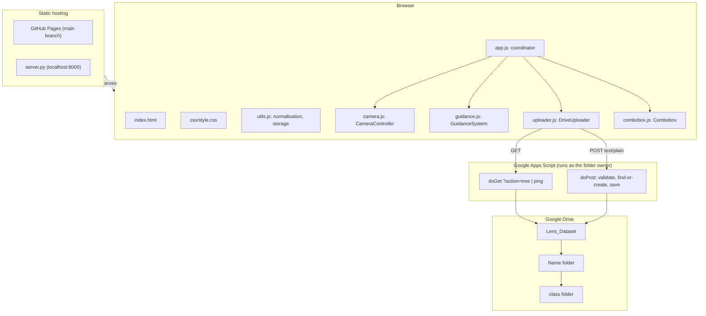

# Architecture

The app is a static, framework-free web client plus a Google Apps Script backend that writes to Google Drive. There is no build step: the files in the repository are served as they are.

---

## 1. Overview



Scripts load in this order (all `defer`): `utils.js`, `camera.js`, `guidance.js`, `uploader.js`, `combobox.js`, `app.js`.

---

## 2. Client modules

### `utils.js` — `window.LensUtils`
- `normalizeName(v)` and `normalizeClass(v)` mirror the backend's `cleanName_` and `cleanClass_`. Keep them identical.
- `fileSafe`, `fileStamp` (`YYYYMMDD-HHMMSS-mmm`), `clockTime`, `randomId`, `compareNames` (Azerbaijani collation).
- `store`: a `localStorage` wrapper that never throws (private mode, blocked storage).

### `camera.js` — `CameraController`
- `start(deviceId)` requests `1280×720@30` as *ideal* constraints. If switching to another camera fails, it restores the previous one.
- Every `start()` gets a sequence number. An older request that resolves late releases its stream and throws `SupersededError`, so rapid switching cannot leak a live camera.
- `onEnded` fires when the camera is unplugged or stopped by the OS.
- `capture()` returns `{ image, thumb, width, height }`: a full-resolution JPEG (quality 0.92, mirrored when mirror is on) and a 160 px thumbnail for the UI.

### `guidance.js` — `GuidanceSystem`
- Five scenarios (10 + 10 + 10 + 10 + 15 frames). `setKey("name|class")` switches progress, which is persisted under `localStorage["lens.progress.v2"]`.
- `record()` counts captures only in wizard mode. It moves on to the next unfinished scenario and returns `"advanced"`, `"finished"` or `null`.
- `analyzeLighting()` computes the mean luma of the centre region of a 64×36 sample: below 55 means too dark, above 215 means overexposed.
- `renderOverlay()` draws rule-of-thirds lines, corner marks and a centre cross inside the area the video actually covers (`object-fit: contain`). It is DPR-aware and redraws only when the geometry changes.

### `uploader.js` — `DriveUploader`
- `fetchTree({ fresh })` reads `GET ?action=tree` and also accepts the v1 `{ folders }` response.
- Queue states: `pending → uploading → success | pending (retry) | failed`.
- Up to 3 uploads run in parallel. Retries back off at 2, 4, 8 and 16 s, and an item is marked `failed` after 5 attempts. Being offline does not use up an attempt; the queue resumes on the `online` event. `retry(id)` and `retryAllFailed()` handle manual retries.
- The full-size image is released once an upload succeeds. `backlog` counts every frame not yet on Drive.

### `combobox.js` — `Combobox`
- A WAI-ARIA combobox (list autocomplete): free text with filtered suggestions, `↑ ↓ Enter Esc`, mouse selection without losing focus.
- Callbacks: `onInput` (live typing), `onCommit` (blur, Enter, pick) and `onEnter`.

### `app.js` — coordinator
- Derives `state.user` / `state.cls` from the inputs while the user types, snapping to an existing folder's spelling (`leyla` → `Leyla`).
- Renders the destination path, the hints that say whether a folder is new or existing, the class chips, the scenario panel, the stats and the recent captures (keyed DOM updates, so thumbnails are never re-decoded).
- Auto-capture runs on `requestAnimationFrame`. It stops when the tab is hidden, a field is cleared, the camera fails or more than 40 frames wait in the queue.
- Keyboard shortcuts are ignored while typing and when a modifier key is held. Key auto-repeat cannot trigger a burst of captures.
- `beforeunload` warns while frames are still waiting to upload.

---

## 3. Backend — `google_drive_script.js` (API v2)

| Call | Behaviour |
|---|---|
| `GET ?action=ping` | `{ "status": "ok", "version": 2 }` |
| `GET ?action=tree[&fresh=1]` | Person folders with their class sub-folders, the union of class names, and the v1 `folders` array. Cached for 60 s unless `fresh=1`. |
| `POST` (text/plain JSON) | Validates the input, finds or creates `<Name>/<class>/` and saves the JPEG with JSON metadata as its description. |

Folder lookup: a CacheService hit is checked (folder not trashed, same name, same parent). On a miss, the backend lists `searchFolders("trashed = false")` and compares names case-insensitively, choosing the oldest folder on ties. Creation happens under `LockService`, with a limit of 200 new folders per hour.

---

## 4. Data schemas

### Upload payload (`POST`)
```json
{
  "v": 2,
  "userName": "Leyla",
  "className": "mouse",
  "fileName": "mouse_Leyla_20261018-164803-123_k3f9.jpg",
  "image": "data:image/jpeg;base64,/9j/4AAQ...",
  "meta": {
    "capturedAt": "2026-10-18T12:48:03.123Z",
    "scenario": 2,
    "mode": "wizard",
    "mirror": true,
    "width": 1280,
    "height": 720,
    "camera": "Integrated Webcam",
    "luminance": 132,
    "app": "web-2.0"
  }
}
```

### Upload response
```json
{
  "status": "success",
  "version": 2,
  "fileId": "1z73PgSD3OT75bvbShseMvKZFZKaQ7C0D",
  "fileName": "mouse_Leyla_20261018-164803-123_k3f9.jpg",
  "folderId": "…class folder id…",
  "folderName": "mouse",
  "userFolderId": "1n7QkbtE7Yp8dPd9P4zQyzoVezOJOwpCQ",
  "userName": "Leyla",
  "className": "mouse",
  "path": "Leyla/mouse"
}
```
On failure: `{ "status": "error", "message": "…" }`.

### Tree response (`GET ?action=tree`)
```json
{
  "status": "ok",
  "version": 2,
  "users": [
    { "id": "1n7Q…", "name": "Leyla", "classes": [ { "id": "18OV…", "name": "mouse" } ] }
  ],
  "classes": ["mouse"],
  "folders": [ { "id": "1n7Q…", "name": "Leyla" } ]
}
```

### localStorage keys
| Key | Content |
|---|---|
| `lens.user` | Last person name (migrated from the v1 key `lens_collector_name`) |
| `lens.class` | Last class |
| `lens.interval` | Auto-capture interval in seconds (0.5–10) |
| `lens.mirror` | Mirror on/off |
| `lens.mode` | `wizard` or `free` |
| `lens.progress.v2` | `{ "leyla\|mouse": { "counts": [..5], "index": 0, "updatedAt": … } }` |
