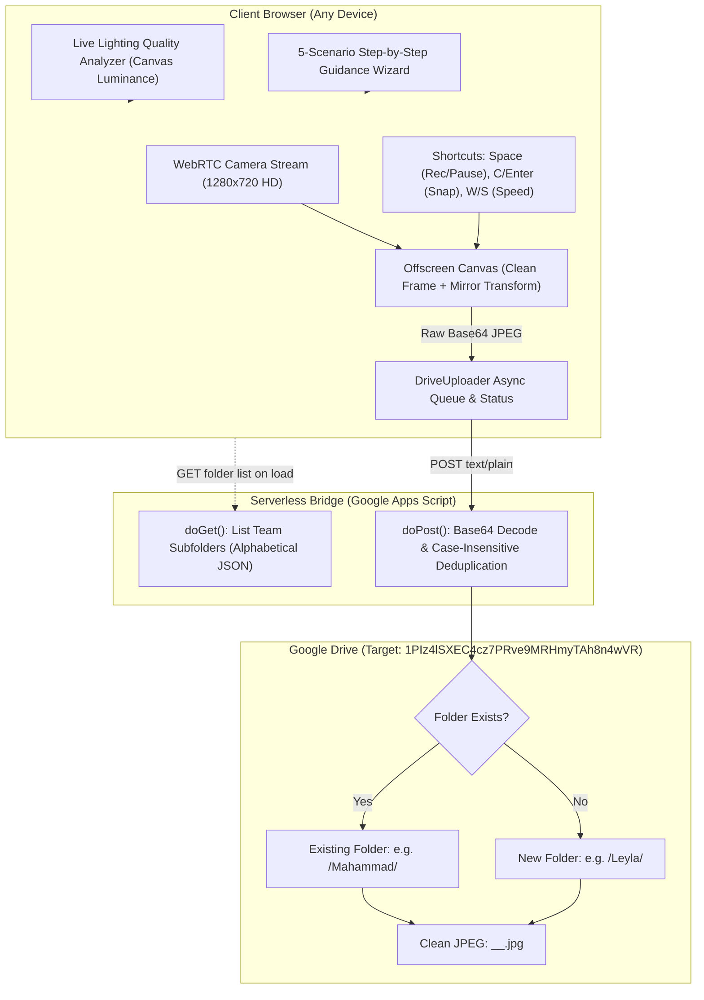

# AI Handover & Master Context Document

> **Target Audience:** Incoming AI Agent / Engineering Team taking over the project.  
> **Last Updated:** 2026-10-18  
> **Project Name:** Lens Detection - Dataset Collection Web Platform  
> **Owner / Author:** Avaz Asgarov (`AvazAsgarov`)  

---

## 1. Executive Summary & Purpose

This platform was engineered to collect computer vision training datasets for **Lens & Phone Detection** (detecting unauthorized cameras/smartphones pointed at computer screens, DLP security use-case). 

The original codebase (`lkazimzadehh/lens-detection`) used a local desktop Python/OpenCV script (`tools/data_collector.py` & `.bat` file). That script was only usable by technical developers on Windows with local Python environments.

**What This Project Achieved:**
Transformed the dataset collection into a **100% cloud-hosted, zero-installation web application** deployable 24/7 on GitHub Pages / Vercel. Non-technical colleagues across an enterprise simply open a URL in Chrome/Edge, select their name, receive real-time UI guidance (lighting check, framing guides, step-by-step angle/distance scenarios), and capture photos. Images are automatically sorted and uploaded to individual employee subfolders in Google Drive with **zero login friction** and **automatic deduplication**.

---

## 2. Key Links, IDs & Credentials

| Resource | Value / URL | Description |
|---|---|---|
| **Live Web App (Production)** | [https://avazasgarov.github.io/lens-dataset-collector/](https://avazasgarov.github.io/lens-dataset-collector/) | 24/7 accessible website for team data collection |
| **GitHub Repository** | [https://github.com/AvazAsgarov/lens-dataset-collector](https://github.com/AvazAsgarov/lens-dataset-collector) | Main source repository |
| **GitHub User Token** | `Stored in Project Chat / Environment` | User PAT with repo scopes (Account: `AvazAsgarov`) |
| **Google Drive Target Folder** | [1PIz4lSXEC4cz7PRve9MRHmyTAh8n4wVR](https://drive.google.com/drive/folders/1PIz4lSXEC4cz7PRve9MRHmyTAh8n4wVR?usp=sharing) | Root Drive folder containing all employee subfolders |
| **Google Apps Script Web App** | `https://script.google.com/macros/s/AKfycbyFU3KixOVpS9I3Iz1w_PiV47tRwiernHbNyOuYSBSo_yILrw_ce6YmDssAfGUlhUak/exec` | Serverless backend bridging the web app to Google Drive API |
| **Reference Repository** | `https://github.com/lkazimzadehh/lens-detection` (cloned locally in `lens-detection-ref/`) | Original ML model, inference shield, and collection tool |

---

## 3. High-Level Architecture

---

## 4. Crucial Technical Invariants & Gotchas

Incoming AI agents must be aware of these non-obvious engineering decisions:

1. **CORS Handling with Google Apps Script (`text/plain;charset=utf-8`):**
   - Google Apps Script Web Apps do **not** support standard CORS `OPTIONS` preflight requests for `application/json`.
   - To bypass the browser preflight and avoid CORS blocking, requests are sent with `Content-Type: text/plain;charset=utf-8`. Google handles the subsequent 302 redirect smoothly, and browser `fetch` completes successfully.
2. **Case-Insensitive Folder Deduplication:**
   - Employees often type their names differently (e.g. `mahammad`, `Mahammad`, `MAHAMMAD`).
   - `google_drive_script.js` iterates all subfolders with `.toLowerCase() === targetLower`. If a match is found, it reuses that folder ID. It **never** creates duplicate folders.
3. **Clean Frame Capture vs HUD Overlay:**
   - The user sees bounding boxes, crosshairs, status badges, and lighting warnings on an HTML5 overlay canvas.
   - The saved training photo is captured from an **offscreen canvas** directly from the raw `<video>` element. The saved training images are 100% clean and free of UI artifacts.
4. **Mirror Mode & Training Domain Invariance:**
   - In `lens-detection-ref`, the inference engine (`src/run_shield.py`) and collector (`tools/data_collector.py`) horizontally flip webcam frames (`cv2.flip(frame, 1)`).
   - In our web client, mirror mode is enabled by default. `captureCleanFrame()` applies `ctx.scale(-1, 1)` so the collected dataset strictly matches the model's expected coordinate domain.
5. **Chrome Multi-Account Redirect Bug:**
   - If opening the Google Apps Script Web App `/exec` URL directly in Chrome with multiple logged-in Google accounts (`authuser=2`), Google displays *"Sorry, unable to open the file at this time"*.
   - This is purely a Google session cookie redirect issue. When accessed via JavaScript `fetch()` or `curl`, the API functions properly and returns clean JSON.

---

## 5. File Inventory & Roles

| Path | Purpose |
|---|---|
| `index.html` | Core Single-Page Application (SPA) layout, Tailwind CSS via CDN, HUD elements |
| `css/style.css` | Glassmorphism, animations, dark mode theme, HUD styles |
| `js/camera.js` | WebRTC controller, device enumeration, offscreen clean frame snapshot |
| `js/guidance.js` | Real-time luminance analyzer, canvas viewfinder overlay, 5-scenario dataset wizard |
| `js/uploader.js` | Background upload queue, retries, stats tracking, folder enumeration client |
| `js/app.js` | Main app coordinator, keyboard shortcuts (`Space`, `C`, `Enter`, `W`, `S`, `M`), Web Audio shutter synthesizer |
| `google_drive_script.js` | Complete Google Apps Script code to deploy on Google Drive |
| `server.py` | Local FastAPI runner serving static files with auto-browser launch |
| `requirements.txt` | Python dependencies for local server (`fastapi`, `uvicorn`) |
| `RUN_Web_App.bat` | Double-click Windows launcher for local offline testing |
| `vercel.json` | Zero-config static deployment for Vercel |
| `.github/workflows/deploy.yml` | GitHub Actions workflow for automatic deployment to GitHub Pages |
| `docs/` | Comprehensive technical documentation suite |

---

## 6. Recommended Next Steps for Incoming Agent

If you are continuing feature development, consider these logical extensions:
1. **Bulk Dataset Download Tool (`tools/sync_from_drive.py`):**
   - Create a Python script that uses Google Drive API or a Service Account to bulk download all employee folders from Drive into local `data/captures/images/` for YOLO retraining.
2. **Roboflow Annotation Batcher:**
   - Integrate with `lens-detection-ref/tools/collect_dataset_images.py` to index downloaded images into `data/all_images` with SHA-256 deduplication and manifest generation.
3. **Negative Class Toggle in Web UI:**
   - Currently, all photos are grouped into the employee's folder. If the team wants explicit negative training data (e.g. empty desks, typing without phone), add a simple toggle button that sets a filename prefix `negative_*.jpg` vs `threat_*.jpg`.
