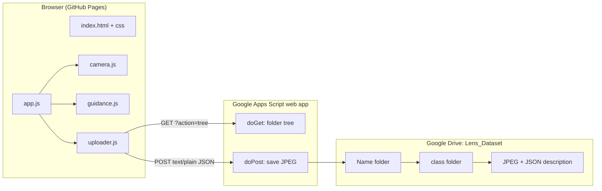

# Handover — Lens Dataset Collector

> **Audience:** the next engineer or AI agent working on this project.
> **Last updated:** 2026-10-18 (v2.0.2)
> **Owner:** Avaz Asgarov (`AvazAsgarov`)

---

## 1. What this is

A zero-install web app for collecting computer-vision training images. Team members open a URL, allow the camera, enter **their name** and **the class of the object** they are photographing (e.g. `mouse`, `notebook`, `phone`), and capture frames. Every frame is uploaded to Google Drive as:

```
Lens_Dataset/<Name>/<class>/<class>_<Name>_<YYYYMMDD-HHMMSS-mmm>_<rand4>.jpg
```

It replaced the desktop OpenCV collector in the reference repo (`lkazimzadehh/lens-detection`, cloned locally into the git-ignored `lens-detection-ref/`).

### v2.0.0 (2026-10-18)

- New **class** input next to the name; Drive layout changed from `<Name>/` to `<Name>/<class>/` (team request from Leyla Kazimzade).
- Apps Script backend rewritten (API v2): nested find-or-create with `LockService`, trashed folders ignored, JPEG validation, idempotent uploads, per-file JSON metadata, folder tree endpoint.
- UI rebuilt without the Tailwind Play CDN: vanilla CSS design system, light/dark themes, accessible combobox inputs, inline errors instead of `alert()`.
- About 90 audited bugs fixed. The main ones: an invisible top HUD, Azerbaijani names mangled into duplicate folders, frames silently dropped after 3 retries, the app dying when the camera failed, keyboard shortcuts hijacking `Ctrl+C` and focused buttons, and a GitHub Actions workflow that failed on every push.

---

## 2. Key links and IDs

| Resource | Value |
|---|---|
| Live site | <https://avazasgarov.github.io/lens-dataset-collector/> |
| Repository | <https://github.com/AvazAsgarov/lens-dataset-collector> |
| Drive root folder (`Lens_Dataset`) | `1PIz4lSXEC4cz7PRve9MRHmyTAh8n4wVR` |
| Apps Script web app (`/exec`) | `https://script.google.com/macros/s/AKfycbyFU3KixOVpS9I3Iz1w_PiV47tRwiernHbNyOuYSBSo_yILrw_ce6YmDssAfGUlhUak/exec` |
| Apps Script project | "Untitled project" in the **AI Factory** Google account (the account that owns `Lens_Dataset`; in the owner's Chrome it is `authuser=2`) |
| Active deployment | Version 6 — "v2.0.2: dublikat qoruması (pending claim)" (2026-10-18) |

Never commit tokens or passwords to this public repository.

---

## 3. Architecture at a glance



Details: [ARCHITECTURE.md](ARCHITECTURE.md).

---

## 4. Invariants — do not break these

1. **`Content-Type: text/plain`.** Apps Script web apps do not answer CORS preflight requests, so the client posts JSON as `text/plain;charset=utf-8`. Do not switch to `application/json`.
2. **Same normalisation on both sides.** `normalizeName` / `normalizeClass` / `nameKey` / `fold` in `js/utils.js` must stay identical to `cleanName_` / `cleanClass_` / `nameKey_` / `fold_` in `google_drive_script.js`. Names: NFC, trimmed, single spaces, no `/` `\` or control characters, max 60 characters, casing kept. Classes: the same, then case-folded (Azerbaijani `İ` → `i` first) with spaces turned into `_`. Folders are matched by these keys, so `LEYLA`, `leyla` and a hand-made `Leyla ` are one folder.
3. **No duplicate folders.** Lookups are case-insensitive and ignore trashed folders. Creation happens inside `LockService.getScriptLock()`. If old duplicates exist, the oldest folder wins.
4. **Uploads are idempotent by file name.** A retried POST whose file already exists (or is still being written by an earlier request) returns that file. File names therefore carry a random suffix and must stay unique.
5. **Capture uses the committed target only.** Live typing changes the preview, not where frames go; editing during auto-capture stops it.
6. **Clean frames only.** The overlay (grid, corner marks, HUD) is drawn on a separate canvas. `CameraController.capture()` reads the raw `<video>` frame.
7. **Mirror.** When mirror is on (the default), the saved frame is flipped too, to match `cv2.flip(frame, 1)` in the reference inference pipeline. The state is recorded in each file's metadata (`mirror`).
8. **Backward compatibility.** The backend still accepts v1 payloads without `className` (it saves into the person folder), and `doGet` still returns the v1 `folders` array.

---

## 5. Operational notes

- **Updating the backend:** paste `google_drive_script.js` into the Apps Script project, then go to Deploy → Manage deployments → ✏️ → *New version* → Deploy. The URL stays the same. See [GOOGLE_DRIVE_INTEGRATION.md](GOOGLE_DRIVE_INTEGRATION.md).
- **Updating the frontend:** push to `main`. GitHub Pages serves the branch directly (legacy "deploy from branch", `.nojekyll`). GitHub Actions cannot run on this account (billing lock), so there is no workflow. Bump the `?v=` query on the CSS and JS tags in `index.html` on every release so browsers drop cached files.
- **Privacy:** the `Lens_Dataset` Drive folder is currently shared as *anyone with the link*, and its ID is public in this repo. That makes every captured photo, including faces and screens, publicly readable. Restricting sharing to the team is recommended, and is the folder owner's call. Uploads keep working when the folder is private because the backend runs as the owner.
- **Abuse surface:** the `/exec` endpoint is public by design (no login for collectors). The backend accepts only JPEG files up to 10 MB, sanitises names, and allows at most 200 new folders per hour.

---

## 6. Suggested next steps

1. A bulk download tool (`tools/sync_from_drive.py`) that mirrors `Lens_Dataset/<Name>/<class>/` into a local YOLO-style layout and reads the JSON description of each file.
2. A per-class dashboard (image counts per person and class) built on `doGet ?action=tree` plus file counts.
3. Optionally, persist the upload queue in IndexedDB so frames survive a crashed tab. Today a `beforeunload` prompt warns the user instead.
